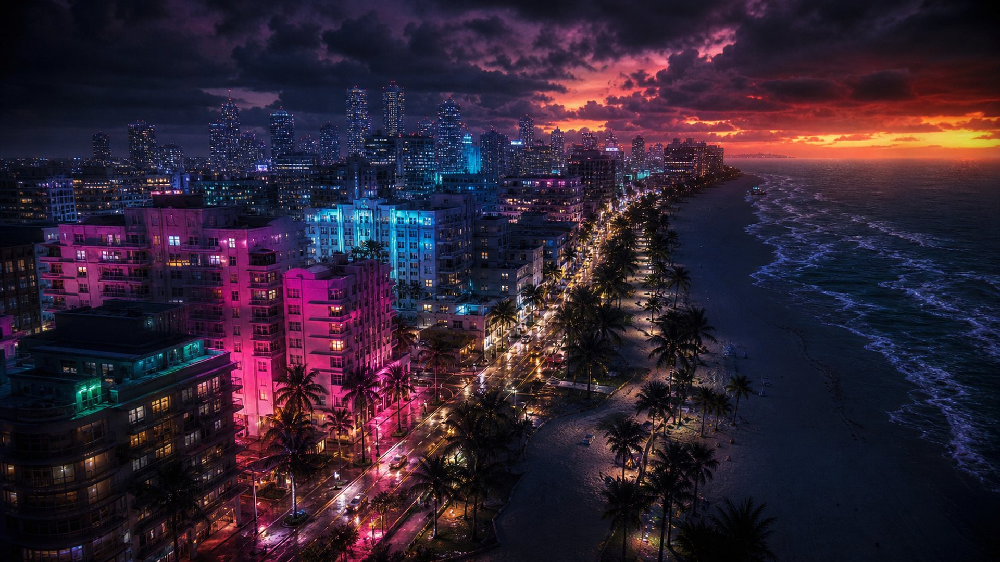

# Design System — S2 / `GTA VI — The Ultimate Guide`

> **Leonida Awaits. Are You Ready?** · fan guide **non officiel** · FR primaire / EN secondaire.
> Référence unique : `workflow_master.yaml`. Données : `research_data.json` (283 faits / 114 sources).
> Tous les assets livrés sont des **JPG** et des **MP3** ; aucun fichier image SVG/PNG/WebP/AVIF.

---

## 1. Chargement des feuilles (ordre obligatoire)

```html
<link rel="preconnect" href="https://fonts.googleapis.com">
<link rel="preconnect" href="https://fonts.gstatic.com" crossorigin>
<link rel="stylesheet" href="assets/css/design_system.css">
<link rel="stylesheet" href="assets/css/animations.css">
<link rel="stylesheet" href="assets/css/components.css">
<link rel="stylesheet" href="assets/css/responsive.css">
```

Les polices Google Fonts sont une **amélioration progressive** : `design_system.css` déclare des
piles système (`Arial Narrow` / `Impact`, `Segoe UI`, `Courier New`, `Trebuchet MS`) pour que
l'aperçu hors réseau reste lisible. En S3, précharger les **2 polices principales**
(Bebas Neue + Inter) et injecter le CSS critique inline.

```html
<script type="module" src="assets/js/components.js"></script>
<script type="module" src="assets/js/animations.js"></script>
```

`components.js` et `animations.js` sont des modules ES6 natifs, **sans dépendance** :
ils s'auto-initialisent au `DOMContentLoaded` et exportent aussi chaque `init*()` pour S3/S4/S5.
`window.gsap` est utilisé seulement s'il est déjà présent (hook optionnel), sinon fallback natif.
Aucun `localhost`, aucun appel réseau externe depuis le JS.

---

## 2. Tokens de couleur

| Token | Valeur | Rôle |
|---|---|---|
| `--c-primary` | `#FF2D78` | Néon Rose Vice City |
| `--c-secondary` | `#00D4FF` | Bleu Électrique Leonida |
| `--c-accent` | `#FFD700` | Or Rockstar |
| `--c-bg-dark` / `--c-bg-mid` / `--c-bg-card` | `#0A0A0F` / `#12121C` / `#1A1A2E` | Fonds |
| `--c-text` / `--c-text-secondary` | `#FFFFFF` / `#B0B8D4` | Texte |
| `--c-success` / `--c-danger` | `#00FF9D` / `#FF4444` | Validation / alerte |
| `--c-sunset` | `#FF8A3D` | S2 · couchers de soleil orange (PCMag 18/11) |
| `--c-violet` | `#8B5CF6` | S2 · néon violet crépusculaire |
| `--c-pastel` | `#FFB8D9` | S2 · hôtels Art déco pastel |
| `--c-teal` | `#2DE1C2` | S2 · lagon des Leonida Keys |
| `--c-deep-purple` | `#2A1B4D` | S2 · ciel de crépuscule |

Dégradés : `--grad-neon`, `--grad-sunset`, `--grad-gold`, `--grad-hero-text`, `--grad-card`.
Typographie : `--font-display` Bebas Neue, `--font-heading` Rajdhani, `--font-body` Inter,
`--font-mono` JetBrains Mono, `--font-ui` Orbitron. Grille `.grid-12` = 12 colonnes,
`.container` = 1320 px. Breakpoints : **320 / 768 / 1024 / 1440 / 2560 px**.

---

## 3. Badges de statut (politique de véracité)

```html
<span class="badge badge--official">Confirmé</span>
<span class="badge badge--press">Presse · 18/11</span>
<span class="badge badge--community">Communauté</span>
<span class="badge badge--leak">Fuite</span>
<span class="badge badge--pending">À compléter</span>
<span class="badge badge--speculative">Estimation</span>
<span class="badge badge--danger">Alerte</span>
```

`official` = Rockstar / Take-Two / PlayStation / Xbox uniquement. Les cheats, 93 missions,
55 trophées, checklist 100 %, astuces et direction artistique du 18/11 sont **`press_confirmed`**.
Jamais de `official` pour une info issue d'une copie de review.

---

## 4. Composants HTML → attributs `data-*`

| Composant | Déclencheur | Notes |
|---|---|---|
| Navbar burger | `[data-nav-burger]`, `[data-nav-drawer]` | `aria-expanded`, Échap, focus, fermeture hors clic. |
| SearchEngine | `[data-search]`, `input`, `[data-search-panel]` | flèches ↑↓, Entrée, Échap, `role=option` ; surcharge `window.GTA6_SEARCH_INDEX`. |
| StatBar | `[data-stat-value]` | remplissage à l'IntersectionObserver. |
| Tooltip | `.tooltip[data-tooltip]` | bulle `role=tooltip`, focus + souris. |
| SpoilerToggle | `[data-spoiler-toggle]` + `aria-controls` | **fermé par défaut** sur missions / trophées / 100 %. |
| CopyButton | `[data-copy]` ou `[data-copy-target]` | `navigator.clipboard` + fallback, toast. |
| BackToTop | `[data-back-to-top]` | anneau `--scroll-progress`. |
| CookieBanner | `[data-cookie-banner]`, `[data-cookie-choice]` | localStorage RGPD minimal. |
| AudioPlayer | `[data-audio-player]` | 10 MP3, surcharge `window.GTA6_AUDIO_TRACKS`, volume, playlist, jamais d'autoplay silencieux imposé. |
| Breadcrumbs | `[data-breadcrumbs]` | généré depuis l'URL. |
| Countdown | `[data-countdown]` + `[data-cd-d/h/m/s]` | 19/11/2026 → bascule « **LANCER LE GUIDE** ». |
| Filtres | `[data-filter-group]`, `[data-filter]`, `[data-filter-target]` | `data-tags="…"` séparés par espaces. |
| Checklist 100 % | `[data-checklist]`, `.checklist__item[data-key]` | `role=checkbox`, Espace/Entrée, localStorage. |
| Quiz | `[data-quiz]` | moteur 5 questions en S2, 30 questions en S5. |
| Étoiles | `[data-wanted="6"]` | 6 étoiles animées, rouge à 6. |

Classes utilitaires : `.container`, `.section`, `.grid-12`, `.grid-auto`, `.panel`, `.glass`,
`.btn btn--primary|gold|ghost|dark|sm|lg|block`, `.card`, `.item-card`, `.notice`, `.chip`,
`.table-wrap`, `.img-frame`, `.t-display`, `.t-gradient`, `.sr-only`, `.skip-link`.

---

## 5. Effets cinématographiques (`animations.js`)

`LoadingScreen` → `GlitchText` → `TypewriterIntro` → `ParallaxHero` → `FloatingParticles`
(canvas) → `CardHover3D` → `CounterAnimation` → `ScrollReveal` → `CursorCustom` → `ScanLines`
→ `WantedStars` → `SmoothScroll` → hooks GSAP optionnels.

- Aucun SVG / PNG / GIF : scanlines = `repeating-linear-gradient`, curseur = `div` + pseudo-éléments,
  particules = `<canvas id="particles-canvas">`, vignette = `radial-gradient`.
- `prefers-reduced-motion: reduce` coupe toutes les boucles, rend `.reveal` visible et restaure le curseur.
- `@media (hover: none)` désactive le tilt 3D et le curseur personnalisé.

Attributs : `[data-loading]`, `[data-typewriter]`, `[data-parallax="0.18"]`, `[data-reveal]`,
`.glitch[data-text]`, `.tilt-card`, `[data-count="146"]`, `[data-wanted="6"]`.

---

## 6. Intégration des 10 JPG (règle utilisateur)

```html

```

- **Toujours** `alt` descriptif SEO, `loading="lazy"`, `width` + `height` explicites.
- Héros / paysages : **1920×1080** ; Jason / Lucia : **1280×1920** (2:3).
- Mention « illustration originale » dans les crédits de page ; **jamais** « capture officielle Rockstar ».
- Voir `assets/images/CREDITS.md` pour les 10 noms de fichiers et les `alt` recommandés.

---

## 7. Intégration des 10 MP3

Le lecteur flottant lit `assets/audio/**/*.mp3` ; les sons UI (`hover`, `click`, `transition`,
`equip`, `quiz`) ne sont armés qu'après une première interaction utilisateur (politique autoplay).
Aucun sample Rockstar / GTA sous licence, aucun WAV, aucune musique officielle. Voir
`assets/audio/CREDITS.md`.

---

## 8. Accessibilité & légal

- `skip-link`, `:focus-visible`, ARIA sur interactifs, navigation clavier complète, cibles ≥ 44 px
  sur tactile, contrastes ≥ 4.5:1, `prefers-contrast: more`, `prefers-reduced-motion`, mode print.
- Mentions obligatoires en footer : **guide de fan non officiel**, Rockstar Games / Take-Two
  Interactive, absence d'affiliation, illustrations IA originales, audio synthétique.
- `research_data.json` + badges : aucune donnée inventée, tout sujet non vérifié reste
  `post_launch_pending` / `community` / `leak_unverified`.
